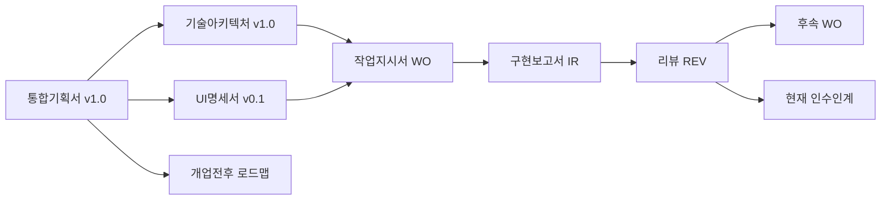

# 음식점 AX — 프로젝트 허브

> 1~2인 운영 음식점의 데이터 입력 부담을 최소화하고, POS·파일·간편 입력 데이터를 공통 파이프라인으로 연결해 판매량·원가·재고 분석에 활용하는 서비스.
> 이 문서는 Vault(`C:\dev\food\DOCS`)의 진입점이다. **새 에이전트/참여자는 여기서 시작한다.**

## 현재 단계

| 항목 | 상태 |
|---|---|
| 제품 단계 | 통합기획서 §4.1 **MVP P0 전 범위(`REQ-001`~`REQ-013`, 화면 `S00`~`S07`) 구현 및 자동 테스트 완료** (양식당 프로토타입) |
| 아키텍처 단계 | 아키텍처 §12 **Phase 1~4 핵심 데이터·원가·재고·분석 파이프라인 구현 완료** |
| 완료된 작업 | `WO-20261025-001` ~ `WO-20261025-009` (전체 vertical slice + 파이프라인 감사 + 태블릿 HOME UI + 2D 도트 메타버스 홀 모두 `DONE`) |
| 최신 인수인계 | [[현재_인수인계]] |
| POS 실연동 | **모드 C(CSV 업로드) 검증 완료 (`READY_CSV`)** / 모드 A·B(토스 Open API·플러그인)는 어댑터 상태만 구현하고 **`UNVERIFIED`로 정직하게 표시** |

## 읽는 순서 (새 에이전트 온보딩)

1. 루트 `AGENTS.md` (Vault 밖, `C:\dev\food\AGENTS.md`)
2. 이 허브 → [[현재_인수인계]]
3. [[음식점_AX_통합기획서_v1.0]] — 제품 기준(source of truth)
4. [[음식점_AX_기술아키텍처_선정및구조_v1.0]] — 기술 구조 기준
5. [[음식점_AX_UI명세서_v0.1]] — 화면·상호작용 기준(초안)
6. [[결정사항_로그]] — 확정/임시/미결정/보류
7. 마지막 작업지시서 → 구현보고서 → 리뷰 ([[#작업 흐름 (WO → IR → REV)]])

## 문서 지도

### 기준 문서 (원본 — DOCS 루트, 수정 시 변경이력 필수)

| 문서 | 역할 | 권위 |
|---|---|---|
| [[음식점_AX_통합기획서_v1.0]] | 제품 목표·범위·데이터 개념·미결정(D-01~D-08) | **제품 방향 최상위** |
| [[음식점_AX_기술아키텍처_선정및구조_v1.0]] | 스택·폴더 구조·API·DB·ADR | 기술 구조 최상위 |
| [[음식점_AX_UI명세서_v0.1]] | 화면 S00~S07, 필드·버튼·규칙 | 초안(v0.1) |
| [[음식점_AX_개업전후_로드맵]] | 사업 단계·맥락 | 참고(현재 MVP 지시 아님) |
| [[AGENTS]] | 원본 에이전트 규약 | [[개발에이전트_작업규약]]으로 통합됨 |
| [[음식점_AX_개발에이전트_시작명령_Obsidian워크플로]] | 이 Vault 운영 체계를 만든 시작 명령 | 프로세스 근거 |

### 운영 문서 (`05_운영/`)

- [[개발에이전트_작업규약]] — **canonical 에이전트 규약**
- [[개발_워크플로]] — 지시서 → 구현 → 보고 → 리뷰 → 수정 절차
- [[문서_검토_요약]] — 6개 문서의 역할·핵심 지침·충돌·누락
- [[결정사항_로그]] — D-xx / ADR / PROVISIONAL / 충돌(C-xx)
- [[요구사항_ID_매핑]] — REQ-### / 화면 ID 정의
- [[인터뷰_기록]] — 사용자 인터뷰 Q&A와 결정 반영
- [[변경이력]] — Vault·기획 변경 이력
- [[현재_인수인계]] — 현재 상태·다음 작업

### 템플릿 (`_templates/`)

- [[TPL_작업지시서]] · [[TPL_구현보고서]] · [[TPL_리뷰]] · [[TPL_테스트기록]]

## 작업 흐름 (WO → IR → REV)

| Slice | WO | IR | REV | TEST | 상태 |
|---|---|---|---|---|---|
| 1 (Skeleton + S03 메뉴 CRUD) | [[WO-20261025-001_첫번째_vertical_slice]] | [[IR-20261025-001_첫번째_vertical_slice]] | [[REV-20261025-001_첫번째_vertical_slice]] | [[TEST-20261025-001_첫번째_vertical_slice]] | **DONE** |
| 2 (A: S04 식자재·레시피) | [[WO-20261025-002_식자재_레시피_관리]] | [[IR-20261025-002_식자재_레시피_관리]] | [[REV-20261025-002_식자재_레시피_관리]] | [[TEST-20261025-002_식자재_레시피_관리]] | **DONE** |
| 3 (B: S00/S07/S02 매장·테이블·방문기록) | [[WO-20261025-003_매장_테이블_홈_방문기록]] | [[IR-20261025-003_매장_테이블_홈_방문기록]] | [[REV-20261025-003_매장_테이블_홈_방문기록]] | [[TEST-20261025-003_매장_테이블_홈_방문기록]] | **DONE** |
| 4 (C: S01 POS 모드·CSV 판매수집·매핑) | [[WO-20261025-004_POS설정_및_CSV판매수집]] | [[IR-20261025-004_POS설정_및_CSV판매수집]] | [[REV-20261025-004_POS설정_및_CSV판매수집]] | [[TEST-20261025-004_POS설정_및_CSV판매수집]] | **DONE** |
| 5 (D: S05 입고·단가이력·실재고·예상재고) | [[WO-20261025-005_입고_실재고_예상재고]] | [[IR-20261025-005_입고_실재고_예상재고]] | [[REV-20261025-005_입고_실재고_예상재고]] | [[TEST-20261025-005_입고_실재고_예상재고]] | **DONE** |
| 6 (E: S06 판매집계·원가시나리오 대시보드) | [[WO-20261025-006_판매집계_원가시나리오_대시보드]] | [[IR-20261025-006_판매집계_원가시나리오_대시보드]] | [[REV-20261025-006_판매집계_원가시나리오_대시보드]] | [[TEST-20261025-006_판매집계_원가시나리오_대시보드]] | **DONE** |
| 7 (전체 코드 최적화 및 데이터 파이프라인 감사) | [[WO-20261025-007_전체코드_최적화_및_파이프라인_감사]] | [[IR-20261025-007_전체코드_최적화_및_파이프라인_감사]] | [[REV-20261025-007_전체코드_최적화_및_파이프라인_감사]] | [[TEST-20261025-007_전체코드_최적화_및_파이프라인_감사]] | **DONE** |
| 8 (태블릿 HOME UI 개편 · 연령 스텝퍼 · 주문 수정/환불) | [[WO-20261025-008_태블릿_홈_UI개편_및_주문수정환불]] | [[IR-20261025-008_태블릿_홈_UI개편_및_주문수정환불]] | [[REV-20261025-008_태블릿_홈_UI개편_및_주문수정환불]] | [[TEST-20261025-008_태블릿_홈_UI개편_및_주문수정환불]] | **DONE** |
| 9 (2D 도트 메타버스풍 매장 홀 배치도 · 캐릭터 착석) | [[WO-20261025-009_2D_도트_메타버스_홀_배치도_및_캐릭터_착석]] | [[IR-20261025-009_2D_도트_메타버스_홀_배치도_및_캐릭터_착석]] | [[REV-20261025-009_2D_도트_메타버스_홀_배치도_및_캐릭터_착석]] | [[TEST-20261025-009_2D_도트_메타버스_홀_배치도_및_캐릭터_착석]] | **DONE** |

## 자주 가는 링크

- 미결정 항목: [[결정사항_로그#미결정 (D-xx)]]
- 문서 충돌: [[결정사항_로그#문서 충돌 (C-xx)]]
- 실행 방법: [[현재_인수인계#실행 및 테스트 방법]]
- 코드: `C:\dev\food\backend`, `C:\dev\food\frontend`, `C:\dev\food\db`
