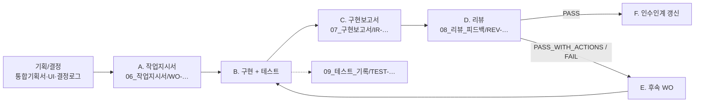

# 개발 워크플로 — 기획 → 지시서 → 구현 → 보고서 → 리뷰 → 피드백/수정

> 근거: [[음식점_AX_개발에이전트_시작명령_Obsidian워크플로]] §3~§4. 작은 작업이라도 최소한의 기록을 남긴다.

## 폴더와 ID

| 단계 | 폴더 | 파일명 | 템플릿 |
|---|---|---|---|
| A 작업지시서 | `06_작업지시서/` | `WO-YYYYMMDD-NNN_작업명.md` | [[TPL_작업지시서]] |
| C 구현보고서 | `07_구현보고서/` | `IR-YYYYMMDD-NNN_작업명.md` | [[TPL_구현보고서]] |
| D 리뷰 | `08_리뷰_피드백/` | `REV-YYYYMMDD-NNN_작업명.md` | [[TPL_리뷰]] |
| 테스트 기록 | `09_테스트_기록/` | `TEST-YYYYMMDD-NNN_작업명.md` | [[TPL_테스트기록]] |
| 보존 | `99_Archive/` | 원본명 유지 + `LEGACY` 표시 | — |

- `NNN`은 같은 날짜 안에서 001부터 증가. WO/IR/REV/TEST는 같은 작업이면 같은 번호를 쓴다.
- Obsidian 코어 플러그인 **Templates**의 템플릿 폴더는 `_templates`로 설정되어 있다(`.obsidian/templates.json`).

## 단계 A — 작업지시서 (구현 전)

필수 항목: 목적/문제 · 범위/비범위 · 관련 `REQ`/`S`/`D`/`ADR` · 선행 조건과 `[[wikilink]]` · 구현 요구사항과 **검증 가능한** 수용 기준 · 테스트 계획 · 위험/미결정/`PROVISIONAL` · 예상 수정 파일 · 완료 조건.
범위가 바뀌면 조용히 확대하지 말고 지시서의 "범위 변경 기록"에 이유와 함께 남긴다. 제품 결정이 필요하면 [[결정사항_로그]] + 사용자 인터뷰.

## 단계 B — 구현

- 지시서 범위로 변경을 제한한다.
- 테스트를 실제로 실행한다. 실패를 성공으로 보고하지 않는다.
- 외부 자격증명/장비가 없으면 mock + 인터페이스까지만, `미검증` 표시.

## 단계 C — 구현보고서

관련 WO 링크 · 구현 ID · 변경 파일과 요약 · 실행 명령/환경변수(비밀 제외) · 실행한 테스트와 결과 · 미구현/차이/이유 · POS 연동 여부/검증 범위 · 알려진 오류/기술 부채/TODO · 문서 변경 여부 · 리뷰어용 확인 방법.

## 단계 D — 리뷰

결과 `PASS` / `PASS_WITH_ACTIONS` / `FAIL`, 발견 사항(심각도 `BLOCKER`/`MAJOR`/`MINOR`/`NIT`), 재현 절차/근거, 수정 권고/우선순위, 후속 WO.
검토 관점: 요구사항 충족 · 데이터 정확성 · 보안 · 예외 상황 · UX · 테스트 커버리지.
별도 리뷰어가 없으면 **`self-review`라고 명시**하고 독립 검증처럼 과장하지 않는다.

## 단계 E — 피드백 반영

원 리뷰 문서를 덮어쓰지 않는다. `REV` → 후속 `WO` → 후속 `IR` → 재검토 `REV` 순으로 연결한다. 모든 항목이 해결되거나 명시적으로 연기된 뒤 작업을 닫는다(`DONE`).

## 단계 F — 인수인계

작업 마지막에 [[현재_인수인계]] 갱신: 현재 구현 상태 · 최근 WO/IR/REV · 열린 이슈/미결정 · 실행/테스트 방법 · 다음 권장 작업과 선행 조건 · 실제 검증 범위 vs mock 범위. 그리고 [[변경이력]]에 한 줄 추가.

## 링크 규칙 체크리스트

- [ ] 주요 문서에 YAML frontmatter(`id`, `type`, `status`, `created`, `updated`, `related`, `source_of_truth`)
- [ ] WO ↔ 기획(REQ/S/D) 링크, IR ↔ WO/TEST/REV 링크, REV ↔ IR/후속 WO 링크
- [ ] 허브의 작업 흐름 표에 새 행 추가
- [ ] 링크 검사 실행: `powershell -File C:\dev\food\DOCS\_scripts\check-links.ps1` (깨진 wikilink 0건 확인)
- [ ] 같은 제목의 중복 파일이 없는지 확인
