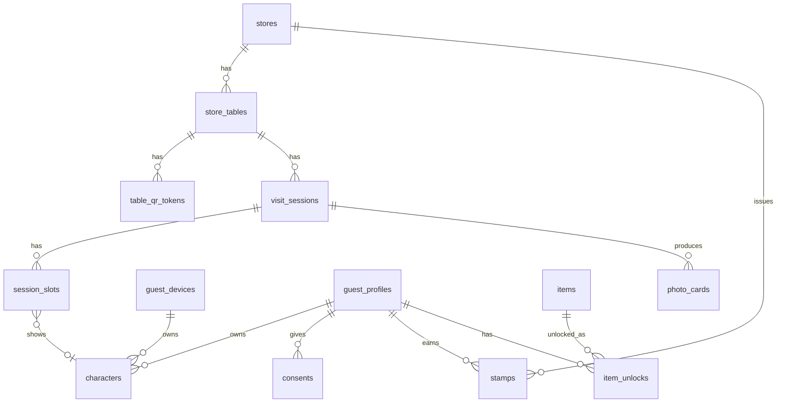

# 손님 영역(B) 흐름 정의 및 ERD 초안

> 상태: **DRAFT**. 인터뷰 8회차(2026-11-04) 결정 U-16~U-22를 정리한 것. [[제품전략_논의_20261030]] §4의 흐름 제안을 구체화하며, 다른 부분이 있으면 이 문서가 최신이다.

## 1. 영역 구분

| 영역 | 내용 | 상태 |
|---|---|---|
| A. 매장 관리·분석 | POS/CSV 수집, 메뉴·식자재·원가·재고, 분석, 직원용 홀 화면(S00~S07) | 구현됨 |
| B. 손님 유치·홍보 | 테이블 QR 모바일 웹, 캐릭터 꾸미기·보상·사진 카드, 매장 TV 도트 홀 | 설계 중 |

두 영역은 **방문 세션** 데이터에서 만난다. A·B는 병렬로 개발하되 이 문서의 데이터 모델과 API 경계를 먼저 고정한다.

- 베타: 양식당 1곳, 초기 채널은 테이블 QR (U-16).
- 화면에는 캐릭터만 보인다. 연령·관계·이름은 띄우지 않는다. 신호가 없는 테이블은 빈 테이블이며 추정으로 사람을 그리지 않는다 (U-17).

## 2. 방문 세션과 슬롯

- **방문 세션(테이블 단위):** 테이블당 열린 세션은 1개(DB 제약으로 강제). 첫 신호(QR 스캔, 직원 입력, 주문 신호)가 열고, 이후 신호는 같은 세션에 합친다. 동시에 들어오면 먼저 저장된 쪽이 열고 나중 요청은 합류자가 된다.
- **슬롯(1명 단위) 상태:**

| 상태 | 매장 TV | 손님 폰 카드 |
|---|---|---|
| `EMPTY` | 빈 의자 | — |
| `SILHOUETTE` | 양식당 테마 단색 실루엣 + "QR 찍으면 내 캐릭터로" | 점선 테두리, "대신 꾸며주기" |
| `EDITING` | 변신 중 애니메이션 | "꾸미는 중", 다른 폰에서 잠김 |
| `CUSTOM` | 꾸민 캐릭터 | 완성 모습 ("나" 표시는 본인 기기만) |

- **인원수 출처 (U-18):** `GUEST_QR` / `STAFF` / `CSV_BACKFILL`. 우선순위: 손님 > 직원. `CSV_BACKFILL`은 영업 후 POS CSV의 주문 시각·테이블 번호로 맞춰 넣은 기록이며 분석에서 따로 볼 수 있게 한다. 화면 표시에는 쓰지 않는다.
- **슬롯 소유:** 슬롯마다 만든 기기(`created_by_device`)와 가져간 기기(`claimed_by_device`)를 둔다. 분석용 출처가 아니라 "대신 만든 캐릭터를 본인이 가져가기"용이다.

## 3. 손님 모바일 흐름

QR 스캔 → 인원 한 번 터치(`[1][2][3][4+]`, 첫 스캔자만) → 내 캐릭터("이대로 등장" 또는 꾸미기) → **우리 테이블** 2열 카드 화면 → 사진 카드 / "다음에도 이 캐릭터로 등장하기"(등록)

우리 테이블 카드 규칙:
- 순서 고정: 내 캐릭터 첫 칸, `+` 마지막 칸. 카드 아래 글자 한 줄로 상태를 적는다 (시니어 고려).
- 합류자는 인원을 다시 입력하지 않는다. "T3 일행 4명 중 1명 등록됨 → 내 캐릭터 만들기".
- `+`: 자리 추가(일행 수 +1). 좌석 수 초과 시 확인. `-`: 빈 실루엣만 지움. 이미 만든 캐릭터 수보다 적게 줄일 수 없음.
- 대신 꾸미기: 빈 자리를 누르면 어른·어린이·어르신 프리셋, 관계 "가족" 선택 시 가족 세트 한 번에 생성. 나중에 본인이 스캔하면 "이 캐릭터가 나예요"로 가져감.
- 인원이 다르게 들어오면 조용히 덮어쓰지 않고 "4명으로 등록돼 있어요. 맞나요?" 확인.
- 방문 목적·관계는 세션 단위로 첫 사람이 한 번 고름. 연령대는 사람 단위 선택 입력.

## 4. 시점별 케이스

| # | 상황 | 처리 |
|---|---|---|
| A | 직원 입력이 먼저, QR은 나중 | 실루엣 N개 → QR 등록 시 실루엣 하나를 캐릭터로 교체 |
| B | QR이 먼저 | QR로 세션 열고 캐릭터 표시. 이후 직원 입력·주문 신호는 같은 세션에 합침 |
| C | 일부만 꾸밈 | 꾸민 캐릭터 + 나머지 실루엣. 각자 등록하거나 대신 꾸미면 하나씩 교체 |
| D | 일행 합류·인원 변경 | `+`/`-`. 꾸민 캐릭터는 지우지 않고 실루엣부터 조정 |
| E | 인원보다 많은 사람이 등록 | 인원 자동 증가, 좌석 수 초과 시 확인 |
| F | 결제 후(재석) 꾸미기 | 허용 |
| G | 퇴점 후 QR 스캔 | 유예 기간 없음. QR은 그 테이블의 열린 세션에 붙고, 없으면 새로 연다. 빈 세션은 아래 퇴점 규칙이 정리 |
| H | 이전 세션이 안 닫힌 채 새 손님 QR | 새 QR 스캔이 이전 세션을 닫고 새 세션을 연다 ("지금 앉으셨나요?" 확인) |
| I | 테이블 이동·합석 | 직원이 세션째 이동 |
| J | 등록 손님 재방문 | QR 로그인 즉시 기존 캐릭터 등장 |
| L | 손님이 화면 노출 끔 | 데이터는 기록, 화면에는 실루엣 |

**퇴점 규칙 (U-19, 수동 입력 최소화):**
1. 같은 테이블의 다음 손님 QR(또는 주문 신호)이 이전 세션을 닫는다.
2. 테이블 전용 디스플레이·태블릿을 도입하면 그 화면의 "비움"으로 닫는다.
3. 안전장치: 장시간 무신호, 영업 종료 시각에 열린 세션 일괄 종료. 퇴점 시각은 추정으로 기록한다.

**테이블오더 연동이 없을 때:** 실시간 신호는 손님 QR과 직원 홀 화면 터치뿐이다. 직원은 안내할 때 인원 한 번, (전용 화면이 있으면) 치울 때 한 번. 정할 숫자(파일럿에서 조정): 안전장치 타임아웃, "새 손님"으로 볼 신호 간격.

## 5. 유도 장치 (U-20)

- 안내 문구: "QR로 캐릭터를 만드시면 저기 화면에 나와요. 음식 기다리시는 동안 해보세요. 방문 쿠폰도 드려요." (무료 음료는 영수증 리뷰 이벤트와 겹쳐 비용이 두 번 나가므로 기본값 아님)
- 보상: 스탬프 = 캐릭터 아이템 해금(기본), 시즌·기념일 한정 아이템, 실물(음료·굿즈)은 잘되면 추가.
- 단체 사진 카드: 우리 테이블 확대, 캐릭터가 카메라를 보고 웃는 포즈 + 매장 이름·로고, SNS 공유용. 실물 출력은 나중.
- 등록: 처음부터 인증 요청하지 않음. 꾸미는 중 "다음에도 이 캐릭터로 등장하기"에서 카카오·네이버 연동 + 동의 후 등록 (U-23). 연동하지 않으면 개인정보는 저장하지 않음. 카카오 채널 고객 관리 연계는 `미검증`.
- 핵심 지표: QR 스캔률(착석 테이블 중 스캔 비율), 꾸미기 완료율, 실루엣 → 캐릭터 전환율.

## 6. 구조와 API 경계

- 모노레포 + 모듈형 모놀리스(ADR-004 유지). 백엔드 모듈: `store_ops`(기존), `hall`(테이블·방문 세션, 공용 핵심), `guest`(QR 토큰·캐릭터·슬롯·보상·등록·동의), `display`(매장 TV 읽기 전용 피드).
- API: 내부 `/api/v1`, 손님 `/api/guest/v1`(QR 토큰, 해당 테이블 세션만), 화면 `/api/display/v1`(읽기 전용 토큰).
- 프론트: 관리 앱(기존), 손님 모바일 웹, 매장 TV 화면. 캐릭터 렌더링은 공용 패키지.
- 매장 격리: [[ADR-013_매장격리_B안_앱계층_RLS]].

## 7. ERD 초안

| 엔티티 | 영역 | 주요 필드 |
|---|---|---|
| `store_tables` | 매장 | 기존 + `store_id` |
| `table_qr_tokens` | 매장 | `store_id`, `table_id`, 추측 불가 토큰, `rotated_at` |
| `visit_sessions` | 매장 | 기존 + `party_size_source`(GUEST_QR/STAFF/CSV_BACKFILL), `opened_by`, `closed_reason`(NEXT_PARTY/CLEARED/TIMEOUT/END_OF_DAY), `purpose`, `relationship` |
| `session_slots` | 매장 | `store_id`, `session_id`, `slot_no`, `state`, `character_id`, `age_band`, `created_by_device`, `claimed_by_device`, `display_opt_out` |
| `stamps` | 매장 | `store_id`, `guest_profile_id`, `visit_session_id` |
| `guest_devices` | 전역 | 익명 기기 토큰(쿠키), `created_at` |
| `guest_profiles` | 전역 | 전역 ID, 연동 제공자(`KAKAO`/`NAVER`)와 제공자 사용자 ID (U-23: 연동 등록 시에만 생성, 연락처 미수집) |
| `characters` | 전역 | `owner_device_id` 또는 `guest_profile_id`, 외형(JSON) |
| `consents` | 전역(+매장) | `guest_profile_id`, `store_id`(매장별 동의일 때만), 종류, 약관 버전, 동의·철회 시각 |
| `items`, `item_unlocks` | 전역(+매장 한정 아이템은 `store_id`) | 아이템 카탈로그, 해금 기록 |
| `photo_cards` | 매장 | `store_id`, `session_id`, 이미지 경로 |

데이터 사전(필드 정의·enum·단위·보유기간)은 개인정보 처리 설계 확정 후 작성한다.
